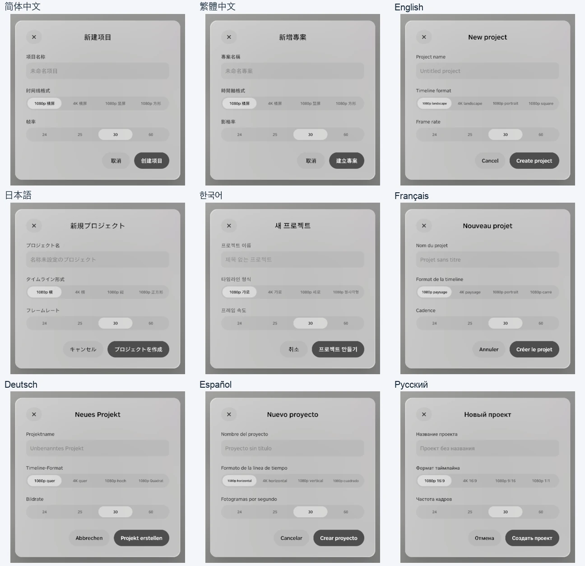

# Translating Reality Video Editor

Choose the globe in the project library or the editor to switch languages. Each language is listed by its own name. **System default** follows Android’s ordered language preferences; a device set to Hong Kong, Taiwan or Macao Chinese uses Traditional Chinese unless the script explicitly says otherwise. If none of the device languages is supported, the interface uses English. Subtitle languages are configured separately.

The product name is **Reality Video Editor** in every language. Keep user-provided project names, media filenames, storage paths, codec names, shortcuts and timecodes intact.



## Edit and check a translation

Simplified Chinese is the source language. The other eight catalogs are UTF-8 files in [app/src/main/resources/i18n](../app/src/main/resources/i18n). Each line contains a source message, a tab and its translation. These files are packaged into the APK; no download or translation service is used at runtime.

- Keep numbered arguments such as `{0}`; they can move to suit the sentence. Preserve literal `\n` and significant whitespace on message fragments.
- Use `tab|` and `compact|` entries when a tab or narrow control needs different wording. Keep endonyms such as 日本語 in their own script.
- For counts, English, French, German and Spanish can use `{0,plural,one{…}other{…}}`. Russian also has `few` and `many`; Chinese, Japanese and Korean can use a plain argument and the appropriate counter.
- When adding a source message, run `python3 devtools/i18n/extract.py` and update all eight catalogs. The unit suite checks coverage, placeholders, script-specific behavior and composed messages.

```sh
python3 devtools/i18n/extract.py --check
./gradlew :app:testDebugUnitTest :app:testReleaseUnitTest
```

## Check an actual interface

Install Python 3 and Pillow for screenshot validation. Use an ARM64 PICO emulator, install a debug APK, and select a sample project that contains media, a timeline and a render job. Run:

```sh
python3 devtools/i18n/check_layout.py --device emulator-5558 --output /tmp/editor-layout
```

Replace the serial with your emulator's. The tool opens the selected project, switches through the nine languages, and captures the library, new project and About sheets, and all five workspaces. It saves PNGs, line measurements, and reports of clipped or overlapping labels and any untranslated messages observed during the tour. Long media filenames in thumbnails are allowed to ellipsize; their full labels remain in the measurements. The tool restores the previous language. The Android instrumentation suite also checks the language picker, persistence, Android’s requested locale order and the device fonts.
