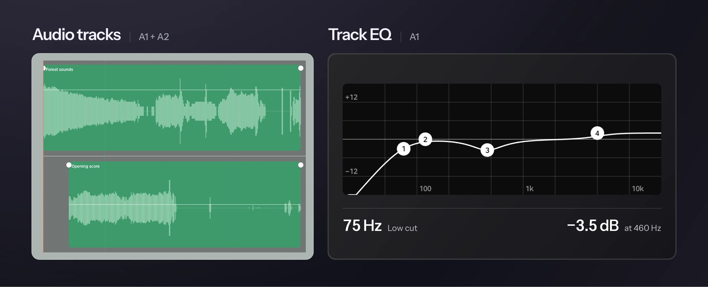

# Reality Video Editor

[English](../../README.md) · [简体中文](zh-Hans.md) · [繁體中文](zh-Hant.md) · **日本語** · [한국어](ko.md) · [Français](fr.md) · [Deutsch](de.md) · [Español](es.md) · [Русский](ru.md)

**PICO Space Pro のための動画編集アプリです。** ヘッドセットをかぶってラフカットを開き、次のカットをほんの少し早めてみる。目の前でシーンの印象が変わります。素材の読み込みから書き出しまでヘッドセットだけで完結。パソコンもアカウントも、インターネット接続も必要ありません。

[オープンソース](../../LICENSE) · [ビルドとインストール](../building.md)

## 残したいテイクを見つける

メディア画面では、サムネイルを見ながら素材をプレビューできます。気に入ったテイクにフラグやキーワードを付ければ、スマートビンが条件に合う素材を自動でまとめてくれます。使用済みのショットだけを集めて、どれを本編に入れたか確認することもできます。

## 目の前に、広い編集スペースを

ウルトラワイド表示では、元の映像と編集中の映像を並べて確認できます。使いたい部分だけをタイムラインに置き、ひとつ前のカットから再生してつながりを確かめてみましょう。大きなファイルは軽いプロキシで編集でき、書き出しには元の素材が使われます。

## 切り替える瞬間を探す

小川が映る少し前に、水の音を聞かせる。映像と音声を別々にトリミングすれば、そんなつなぎ方ができます。尺を詰めるときはリップル編集で後続のクリップもまとめて移動。拡大率に2つのキーフレームを打てば、ゆっくり寄る演出に。動きそのものを徐々に遅くしたいときは速度ランプが使えます。

映像と音声はそれぞれ最大8トラック。複数台で撮影した素材は、別録りの音声を波形で同期し、タイムライン上でカメラを切り替えられます。

## 違う光のカットを、ひとつのシーンに

日なたの草地から木陰の小川へ。シャドウ・中間調・ハイライトをカラーホイールで整え、波形とRGBパレードでカット間の違いを確かめます。基準にしたい画をスチルとして残して次のカットと比較したり、お気に入りの .cube LUT を読み込んだりできます。

## 声がきちんと届くミックスに

ナレーションを音声トラックへ直接録音。声のこもりをEQで整え、話している間だけBGMを自動で下げられます。細部はトラックをソロにして聴き、書き出す前にLUFSメーターで作品全体のラウドネスを確認できます。

## 一本のタイムラインから、必要な形で書き出す

作品全体、イン点とアウト点で指定した区間、あるいは個別のクリップをキューに追加。H.264・H.265の動画、静止画、音声作業用のWAVを書き出せます。字幕は映像に焼き込むことも、SRTやWebVTTで別に渡すこともできます。利用できる解像度とコーデックはヘッドセットのエンコーダーによって異なります。

## Reality Video Editor を使ってみる

ヘッドセットまたは対応するPICOエミュレーターで動かすには、[ビルドとインストールの手順（英語）](../building.md)をご覧ください。プロジェクトライブラリやエディターの地球儀アイコンから、9種類の表示言語を選べます。字幕の言語は個別に設定できます。

本プロジェクト独自のコードとアートワークは[MITライセンス](../../LICENSE)で公開しています。依存ライブラリや素材のクレジットは[第三者の権利に関する表記](../../THIRD_PARTY_NOTICES.md)をご覧ください。

デモ映像：『Big Buck Bunny』© 2008 Blender Foundation / [www.bigbuckbunny.org](https://peach.blender.org/)（[CC BY 3.0](https://creativecommons.org/licenses/by/3.0/)）。スクリーンショットには作品の一部を編集して使用しています。
