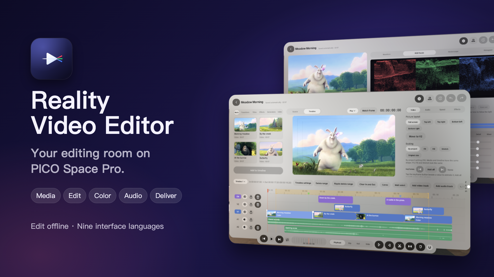

# Reality Video Editor

[English](../../README.md) · [简体中文](zh-Hans.md) · [繁體中文](zh-Hant.md) · [日本語](ja.md) · **한국어** · [Français](fr.md) · [Deutsch](de.md) · [Español](es.md) · [Русский](ru.md)

**PICO Space Pro를 위해 만든 동영상 편집기입니다.** 헤드셋을 쓰고 가편집본을 열어 다음 컷을 반 박자만 당겨 보세요. 눈앞에서 장면의 호흡이 달라집니다. 원본 영상과 편집 내용, 완성본은 모두 헤드셋에 남습니다. 컴퓨터나 계정, 인터넷 연결 없이 한 편을 끝까지 만들 수 있습니다.

[오픈 소스](../../LICENSE) · [빌드 및 설치](../building.md)

## 남기고 싶은 테이크 고르기

미디어 화면에서는 썸네일 옆에서 선택한 원본을 미리 볼 수 있습니다. 마음에 드는 테이크에 깃발이나 키워드를 붙이면 스마트 보관함이 조건에 맞는 클립을 모아 줍니다. 이미 사용한 장면만 모아 어떤 컷을 편집본에 넣었는지도 확인할 수 있습니다.

## 눈앞에 펼쳐지는 넓은 편집 공간

울트라와이드 레이아웃을 열면 원본과 타임라인 영상을 나란히 볼 수 있습니다. 쓸 부분만 골라 타임라인에 놓고 앞 컷부터 재생해 보세요. 파일이 크면 가벼운 프록시로 편집하세요. 최종 출력에는 원본을 사용합니다.

## 딱 맞는 컷의 타이밍 찾기

화면에 개울이 보이기 전에 물소리부터 들려주세요. 영상과 소리의 시작점을 따로 다듬을 수 있고, 리플 편집으로 한 컷을 줄이면 뒤의 클립도 함께 당겨집니다. 크기 키프레임 두 개로 화면을 천천히 당겨 오거나, 속도 램프로 동작 자체가 서서히 느려지게 할 수도 있습니다.

영상과 오디오를 각각 최대 8개 트랙에 배치할 수 있습니다. 여러 대의 카메라로 촬영했다면 별도 녹음한 소리를 파형으로 동기화하고 타임라인에서 앵글을 바꿔 보세요.

## 빛이 다른 두 컷을 하나의 장면으로

햇빛 아래의 풀밭과 그늘진 개울은 서로 다른 날 찍은 것처럼 보일 수 있습니다. 컬러 휠로 어두운 영역과 중간톤, 밝은 영역을 맞춘 다음 파형과 RGB 퍼레이드로 두 컷의 차이를 살펴보세요. 기준이 될 프레임을 저장해 다음 컷과 비교하거나 즐겨 쓰는 .cube LUT를 불러올 수도 있습니다.

## 목소리가 묻히지 않게

오디오 트랙에 바로 내레이션을 녹음하세요. 먹먹한 목소리는 EQ로 정리하고, 사람이 말할 때는 음악이 자동으로 작아지게 할 수 있습니다. 트랙 하나만 따로 들어 조정 효과를 확인하고 내보내기 전에는 LUFS 미터로 전체 음량을 점검하세요.

## 하나의 타임라인에서 여러 가지 결과물로

작품 전체, 시작점과 끝점 사이 구간, 또는 개별 클립을 렌더 대기열에 넣을 수 있습니다. H.264나 H.265 동영상을 출력하고, 한 프레임을 이미지로 저장하거나 사운드 작업용 WAV를 내보내세요. 자막은 영상에 입히거나 SRT 또는 WebVTT 파일로 따로 전달할 수 있습니다. 가능한 해상도와 코덱은 헤드셋의 인코더에 따라 다릅니다.

## Reality Video Editor 시작하기

헤드셋이나 호환되는 PICO 에뮬레이터에서 실행하려면 [빌드 및 설치 안내(영어)](../building.md)를 참고하세요. 프로젝트 라이브러리 또는 편집기의 지구본 아이콘에서 9가지 인터페이스 언어를 선택할 수 있습니다. 자막 언어는 따로 설정합니다.

프로젝트 자체 코드와 아트워크에는 [MIT 라이선스](../../LICENSE)가 적용됩니다. 라이브러리의 이용 조건과 자료 출처는 [서드 파티 고지](../../THIRD_PARTY_NOTICES.md)에서 확인할 수 있습니다.

데모 영상: 《Big Buck Bunny》, © 2008 Blender Foundation / [www.bigbuckbunny.org](https://peach.blender.org/) ([CC BY 3.0](https://creativecommons.org/licenses/by/3.0/)). 스크린샷에는 영화에서 발췌해 편집한 장면을 사용했습니다.
