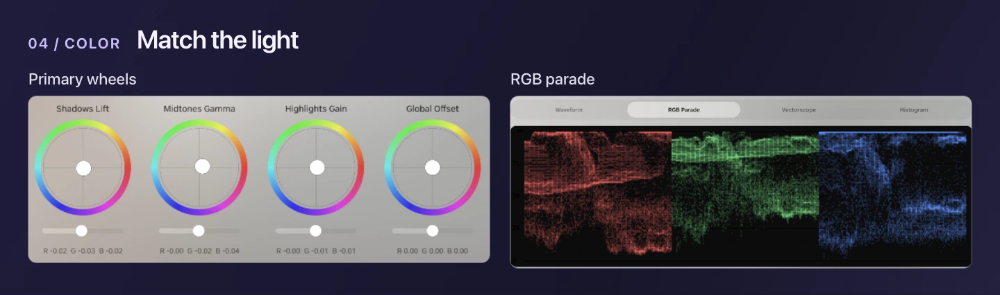

# Reality Video Editor

[English](../../README.md) · [简体中文](zh-Hans.md) · [繁體中文](zh-Hant.md) · [日本語](ja.md) · **한국어** · [Français](fr.md) · [Deutsch](de.md) · [Español](es.md) · [Русский](ru.md)

**PICO Space Pro를 위해 만든 오프라인 영상 편집기입니다.** 두 대의 카메라로 찍은 인터뷰를 편집하다 보면, 대답 직전 듣는 사람의 표정이 가장 좋은 컷일 때가 있습니다. 그 표정을 소스 모니터에 띄워 두고 타임라인에서 대사를 들으며 어느 단어에서 화면을 넘길지 정해 보세요. 가편집부터 색 보정, 사운드 믹싱, 최종 출력까지 한 프로젝트로 이어집니다. 원본은 헤드셋 안에 보관되며, 계정이나 인터넷 연결 없이 편집할 수 있습니다.

<a href="../images/reality-video-editor.png">
  <picture>
    <source media="(max-width: 640px)" srcset="../images/showcase/narrow/cover.webp">
    
  </picture>
</a>

[오픈 소스](../../LICENSE) · [빌드 및 설치](../building.md)

## 남기고 싶은 테이크 고르기

미디어 풀의 썸네일 옆에서 선택한 테이크를 바로 재생합니다. 장면과 숏, 테이크 번호를 기록하고 마음에 드는 컷에 깃발을 달거나 “웃음이 끝날 때까지”처럼 메모를 남겨 두세요. 리액션 숏에 키워드를 붙이고, 좋은 테이크로 표시한 것 중 아직 쓰지 않은 숏만 모으는 스마트 보관함을 만들 수 있습니다. 타임라인에 숏을 넣을 때마다 목록도 갱신됩니다.

아래 작업 예시는 20초짜리 단편 *Meadow Morning*입니다. 영상 네 개와 오디오 두 개가 담긴 미디어 풀에서 개울 장면을 골라 미리 보는 모습입니다.

<a href="../images/showcase/media.webp">
  <picture>
    <source media="(max-width: 640px)" srcset="../images/showcase/narrow/media.webp">
    
  </picture>
</a>

## 눈앞에 펼쳐지는 넓은 편집 공간

울트라와이드 레이아웃에서는 트랙 위에 소스 모니터와 타임라인 모니터가 나란히 놓입니다. 살리고 싶은 답변의 시작점과 끝점을 표시한 다음, 뒤쪽 컷을 밀어 자리를 만들려면 삽입하고 같은 길이의 구간을 바꾸려면 덮어씁니다. 키보드를 연결하면 **I**와 **O**로 구간을 지정할 수 있습니다. 편집본 속 표정이 나온 원본을 찾으려면 그 자리에 재생 헤드를 두고 **F**를 누르세요. 매치 프레임으로 같은 프레임이 열리면 조그 다이얼로 그다음을 한 프레임씩 확인할 수 있습니다.

용량이 큰 카메라 원본은 가벼운 프록시를 만들어 재생하고, 최종 렌더링에는 원본을 사용합니다.

<a href="../images/showcase/workspace.webp">
  <picture>
    <source media="(max-width: 640px)" srcset="../images/showcase/narrow/workspace.webp">
    
  </picture>
</a>

## 딱 맞는 컷의 타이밍 찾기

개울이 보이기 몇 프레임 전부터 물소리를 들려주세요. 영상과 소리를 따로 다듬으면 이런 J컷을 만들 수 있습니다. 장면이 늘어진다면 리플 트림으로 뜸을 줄여 뒤의 컷을 함께 당깁니다. 편집점이 이미 음악의 박자와 맞는다면 슬립 편집으로 앞뒤 편집점을 고정한 채 같은 테이크에서 더 좋은 동작을 골라 넣을 수 있습니다.

영상과 오디오는 각각 최대 8트랙까지 쓸 수 있습니다. 두 대로 찍은 인터뷰라면 파형으로 외부 녹음과 카메라 소리를 맞춘 다음, 대사가 이어지는 동안 화면의 앵글만 바꿔 보세요. 느긋하게 다가가는 장면은 크기 키프레임 두 개로, 움직임 자체가 서서히 느려지는 장면은 속도 램프로 만들 수 있습니다.

<a href="../images/showcase/timeline.webp">
  <picture>
    <source media="(max-width: 640px)" srcset="../images/showcase/narrow/timeline.webp">
    
  </picture>
</a>

## 빛이 다른 두 컷을 하나의 장면으로

햇빛이 드는 풀밭에서 그늘진 개울로 넘어갈 때 두 숏의 빛은 어떻게 맞출까요? 첫 숏을 기본 컬러 휠로 보정하고 스틸을 저장한 뒤, 다음 숏과 분할 화면으로 비교합니다. 파형으로 암부의 밝기를 확인하고 RGB 퍼레이드에서 색이 치우친 채널을 찾으세요. 스틸의 보정값을 다음 숏에 적용해 시작하거나 평소 쓰던 .cube LUT를 불러올 수 있습니다.

인물의 얼굴이 그늘로 들어갈 때는 가장자리가 부드러운 윈도를 얼굴에 놓고 움직임을 추적해 그 안만 밝힐 수 있습니다. 같은 클립에 다른 보정 버전을 저장해 조금 더 따뜻한 색감과 번갈아 비교해 보세요.

<a href="../images/showcase/color.webp">
  <picture>
    <source media="(max-width: 640px)" srcset="../images/showcase/narrow/color.webp">
    
  </picture>
</a>

## 목소리가 묻히지 않게

장면의 호흡이 생생할 때 오디오 트랙에 내레이션을 바로 녹음하세요. 대사 트랙을 솔로로 들어 보며 탁한 소리는 EQ로, 날카로운 치찰음은 디에서로 다듬을 수 있습니다. 말할 때는 배경 음악을 자동으로 낮추고, 숲의 환경음과 다른 효과음은 하나의 믹스 버스로 보내 페이더 하나로 함께 조절합니다.

마지막으로 처음부터 끝까지 들으며 두 수치를 살펴보세요. 통합 라우드니스(LUFS)는 작품 전체가 얼마나 크게 들리는지, 트루 피크는 가장 큰 순간에 클리핑까지 여유가 얼마나 남았는지 알려 줍니다.

<a href="../images/showcase/audio.webp">
  <picture>
    <source media="(max-width: 640px)" srcset="../images/showcase/narrow/audio.webp">
    
  </picture>
</a>

## 세로 편집본을 만들고 언어별 자막 입히기

가로 본편이 확정된 뒤 15초짜리 세로 예고편이 필요하면 타임라인을 복제하세요. 두 버전은 미디어 풀을 공유합니다. 사본의 화면비를 9:16으로 바꾸고 인물의 위치를 세로 화면에 맞춘 다음 휴대폰으로 볼 사람을 위해 도입부를 짧게 다듬습니다. 정사각형 화면도 선택할 수 있습니다.

타임코드가 있는 SRT나 WebVTT 자막을 불러와 언어별로 트랙을 나누면 같은 편집본에 맞춰 검수할 수 있습니다. 영상에 입힐 자막 트랙을 고르거나 언어마다 별도의 자막 파일을 납품할 수 있습니다.

## 하나의 타임라인에서 여러 가지 결과물로

타임라인 전체를 렌더 대기열에 넣거나, 검토받을 구간만 시작점과 끝점으로 표시하거나, 클립을 하나씩 내보낼 수 있습니다. H.264 또는 H.265 영상, 썸네일용 스틸, 사운드 편집자에게 건넬 WAV 중 필요한 결과물을 만드세요. 지원하는 해상도와 코덱은 헤드셋의 인코더에 따라 달라집니다. 아래 프레임과 대기열의 완료 기록은 모두 *Meadow Morning*을 1080p, 30fps로 내보낸 결과입니다.

<a href="../images/showcase/deliver.webp">
  <picture>
    <source media="(max-width: 640px)" srcset="../images/showcase/narrow/deliver.webp">
    
  </picture>
</a>

## 다음 편집자가 이어서 작업할 수 있게 넘기기

다른 편집자에게 넘길 때 FCPXML 1.10으로 내보내면 여러 영상·오디오 트랙의 편집점과 마커, 기본 타이틀을 전달할 수 있습니다. 다시 연결할 원본과 함께 색 보정과 효과의 의도를 확인할 참고 영상을 보내세요. 간단한 편집 목록이 필요할 때는 V1과 첫 두 오디오 트랙을 담는 CMX 3600 EDL이 적합합니다. 두 형식 모두 새 타임라인으로 불러올 수 있으며 파일 이름으로 미디어 풀의 기존 소재와 연결합니다.

## Reality Video Editor 시작하기

헤드셋이나 호환되는 PICO 에뮬레이터에서 실행하려면 [빌드 및 설치 안내(영어)](../building.md)를 참고하세요. 프로젝트 라이브러리 또는 편집기의 지구본 아이콘에서 9가지 인터페이스 언어를 선택할 수 있습니다. 자막 언어는 따로 설정합니다.

프로젝트 자체 코드와 아트워크에는 [MIT 라이선스](../../LICENSE)가 적용됩니다. 라이브러리의 이용 조건과 자료 출처는 [서드 파티 고지](../../THIRD_PARTY_NOTICES.md)에서 확인할 수 있습니다.

데모 영상: 《Big Buck Bunny》, © 2008 Blender Foundation / [www.bigbuckbunny.org](https://peach.blender.org/) ([CC BY 3.0](https://creativecommons.org/licenses/by/3.0/)). 스크린샷에는 영화에서 발췌해 편집한 장면을 사용했습니다.
