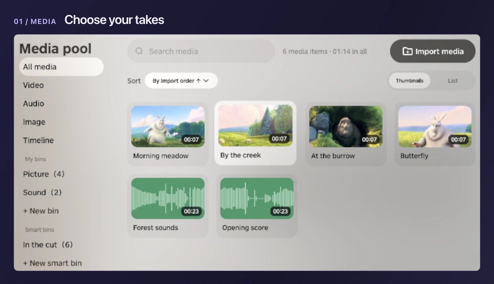

# Reality Video Editor

[English](../../README.md) · [简体中文](zh-Hans.md) · [繁體中文](zh-Hant.md) · [日本語](ja.md) · [한국어](ko.md) · [Français](fr.md) · [Deutsch](de.md) · [Español](es.md) · **Русский**

**Видеоредактор для PICO Space Pro.** Наденьте гарнитуру, откройте черновой монтаж и сдвиньте склейку на несколько кадров. Ритм сцены меняется прямо у вас перед глазами. Исходный материал, проект и готовый фильм остаются на гарнитуре. Для работы не нужны компьютер, учётная запись или интернет.

[Открытый исходный код](../../LICENSE) · [Сборка и установка](../building.md)

## Найдите нужный дубль

На странице материалов миниатюры видны рядом с окном предпросмотра. Отметьте удачный дубль флажком или добавьте ключевое слово: умная папка сама соберёт клипы по заданному условию. Можно вывести только те планы, которые вы уже включили в монтаж.

## Два монитора перед глазами

В сверхшироком режиме исходный кадр и результат монтажа видны рядом. Отметьте нужный фрагмент, перенесите его на монтажную линейку и просмотрите стык с предыдущим планом. С тяжёлыми файлами удобно работать через облегчённые прокси. При экспорте редактор вернётся к оригиналам.

## Поймайте момент для склейки

Пусть зритель сначала услышит ручей и только потом его увидит. Границы изображения и звука можно двигать отдельно. Если укоротить план со сдвигом, следующие клипы подтянутся за ним. Два ключевых кадра масштаба дадут плавное приближение. А чтобы замедлилось само движение в кадре, используйте плавное изменение скорости.

Доступно до восьми видеодорожек и восьми звуковых. Для многокамерной съёмки можно синхронизировать отдельную звукозапись по форме волны и переключать ракурсы прямо на монтажной линейке.

## Сведите два плана по цвету

Солнечная поляна и ручей в тени иногда выглядят так, будто их сняли в разные дни. Отрегулируйте тени, средние тона и света цветовыми кругами, а различия проверьте по осциллограмме и RGB-параду. Сохраните опорный кадр, чтобы сверить с ним следующий план, или загрузите привычную LUT в формате .cube.

## Оставьте место для голоса

Запишите закадровый текст прямо на звуковую дорожку. Добавьте разборчивости глухому голосу эквалайзером и настройте автоматическое приглушение музыки во время речи. Любую дорожку можно прослушать отдельно, а перед экспортом проверить громкость всей работы в LUFS.

## Один монтаж — несколько вариантов экспорта

Добавьте в очередь весь фильм, участок между точками входа и выхода или отдельные клипы. Сохраните видео в H.264 или H.265, извлеките стоп-кадр или передайте звук отдельным WAV-файлом. Субтитры можно встроить в изображение или приложить в формате SRT либо WebVTT. Доступные разрешения и кодеки зависят от кодировщика гарнитуры.

## Попробуйте Reality Video Editor

Чтобы запустить проект на гарнитуре или совместимом эмуляторе PICO, откройте [инструкцию по сборке и установке (на английском)](../building.md). Нажмите на значок глобуса в библиотеке проектов или в редакторе, чтобы выбрать один из девяти языков интерфейса. Язык субтитров настраивается отдельно.

Исходный код и графические материалы, созданные для проекта, доступны по [лицензии MIT](../../LICENSE). Лицензии зависимостей и сведения об авторах приведены в [уведомлениях о сторонних материалах](../../THIRD_PARTY_NOTICES.md).

Кадры для демонстрации: *Big Buck Bunny*, © 2008 Blender Foundation / [www.bigbuckbunny.org](https://peach.blender.org/) ([CC BY 3.0](https://creativecommons.org/licenses/by/3.0/)). Для этих снимков экрана использованы монтажные фрагменты фильма.
