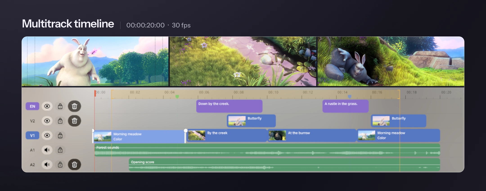

# Reality Video Editor

[English](../../README.md) · **简体中文** · [繁體中文](zh-Hant.md) · [日本語](ja.md) · [한국어](ko.md) · [Français](fr.md) · [Deutsch](de.md) · [Español](es.md) · [Русский](ru.md)

**为 PICO Space Pro 打造的视频剪辑软件。** 戴上头显，打开粗剪，试试把下一个镜头提前半拍，看看整个场景有什么不同。从导入素材到导出成片，都在头显本地完成，无需电脑、账号或网络连接。

[开源项目](../../LICENSE) · [编译与安装](../building.md)

## 找到想留下的那个镜头

在素材页，一边看缩略图，一边预览选中的原片。给喜欢的镜头加旗标或关键词，再让智能素材箱自动把符合条件的片段收在一起。还可以像图中这样，建一个只显示已用素材的箱子，马上就知道哪些镜头已经进了成片。

## 把剪辑台在眼前展开

切换到超宽布局，原始素材和时间线预览就能并排显示。先在原片上选好要用的一段，再放上时间线，看看它和上一个镜头接得顺不顺。遇到大文件，可以先用轻量的代理文件剪辑；导出时仍然使用原片。

## 找到该切的那一帧

可以让观众先听见溪水，再看见溪流。画面和声音各自修剪；需要缩短一段时，用波纹剪辑让后面的片段一起前移。给缩放设两个关键帧，就能做出缓慢推近的效果；想让动作本身慢下来，可以用变速曲线逐渐转为慢动作。

时间线最多容纳八条视频轨和八条音频轨。多机位拍摄时，还可以按波形同步单独录下的声音，在时间线上切换机位。

## 让相邻的镜头像发生在同一天

一边是阳光下的空地，一边是树荫里的小溪。用色轮分别调整阴影、中间调和高光，再对照波形图和 RGB 分量图，判断两段画面的亮度、色彩还差多少。留一张参考静帧给下个镜头比对，也可以导入自己常用的 .cube LUT。

## 给人声留出位置

直接在头显上把旁白录进音轨。声音发闷，可以用均衡器修整；旁白响起时，可以让音乐自动降低。用独听检查其中一轨，最后再用 LUFS 响度表确认整段听起来是否舒服。

## 同一条时间线，交付不同版本

可以把整部短片、入点和出点之间的一段，或单个片段加入渲染队列。导出 H.264 或 H.265 视频，保存一张静帧，或交一份 WAV 给做声音的搭档。字幕可以烧录到画面里，也可以另存为 SRT 或 WebVTT。可选分辨率和编码格式取决于头显的编码器。

## 开始使用 Reality Video Editor

要在头显或兼容的 PICO 模拟器上运行，请参阅[编译与安装指南（英文）](../building.md)。进入项目库或剪辑界面后，点地球图标即可在九种界面语言之间切换。字幕语言可以单独设置。

项目的原创代码和美术资源采用 [MIT 许可证](../../LICENSE)。依赖许可及素材署名请见[第三方声明](../../THIRD_PARTY_NOTICES.md)。

演示画面选自《Big Buck Bunny》，© 2008 Blender Foundation / [www.bigbuckbunny.org](https://peach.blender.org/)（[CC BY 3.0](https://creativecommons.org/licenses/by/3.0/)）。截图中的片段经过剪辑。
