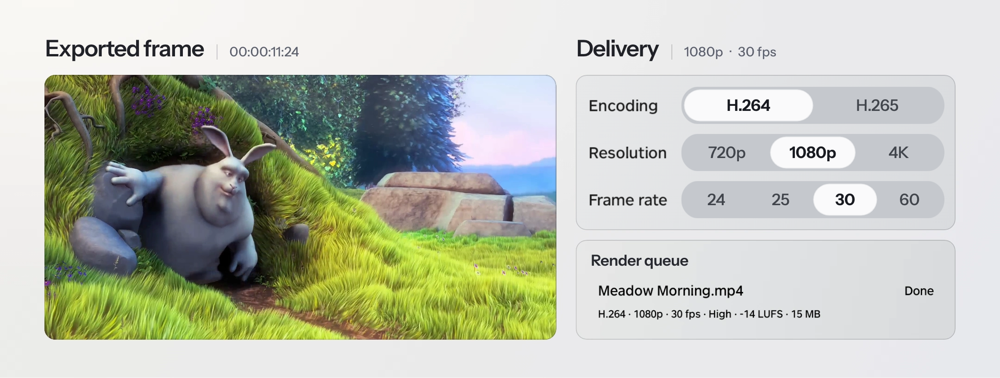

# Reality Video Editor

[English](../../README.md) · **简体中文** · [繁體中文](zh-Hant.md) · [日本語](ja.md) · [한국어](ko.md) · [Français](fr.md) · [Deutsch](de.md) · [Español](es.md) · [Русский](ru.md)

**为 PICO Space Pro 打造的离线视频剪辑软件。** 剪双机位访谈时，最值得留下的有时是对方开口前的那个眼神。把反应镜头停在原片监视器里，一边听时间线上的对白，一边找该在哪个字切过去。从粗剪、调色、混音到导出，这个项目都可以在头显里完成。素材留在设备上，剪片无需账号，也无需联网。

<a href="../images/reality-video-editor.png">
  <picture>
    <source media="(max-width: 640px)" srcset="../images/showcase/narrow/cover.webp">
    
  </picture>
</a>

[开源项目](../../LICENSE) · [编译与安装](../building.md)

## 找到想留下的那个镜头

审素材时，缩略图和选中镜头的预览并排显示。记下场次、镜号和条次，给满意的镜头加旗标，或者留一句“笑完再切”。给反应镜头打上关键词，再建一个智能素材箱，把标为好条、但还没用到的镜头收在一起。每用掉一个，箱里的清单就跟着更新。

下面这组图记录了一支 20 秒短片的剪辑过程，片名是 *Meadow Morning*。四段画面、两段声音放在同一素材池里；图中的溪边镜头可以先预览，再决定从哪里剪进去。

<a href="../images/showcase/media.webp">
  <picture>
    <source media="(max-width: 640px)" srcset="../images/showcase/narrow/media.webp">
    
  </picture>
</a>

## 把剪辑台在眼前展开

超宽布局把原片和时间线监视器并排放在轨道上方。听到一段好回答，标好入点和出点：用插入剪辑给它腾出位置，后面的镜头会顺延；用覆盖剪辑就能换掉时间线上等长的一段。接上键盘，**I** 和 **O** 可以标记入出点。想看成片里那个眼神之后发生了什么，把播放头停在那里，按 **F** 匹配到原片的同一帧，再用走带转盘逐帧往后看。

遇到大体积的相机素材，可以生成轻量代理来预览和剪辑，最终渲染仍使用原片。

<a href="../images/showcase/workspace.webp">
  <picture>
    <source media="(max-width: 640px)" srcset="../images/showcase/narrow/workspace.webp">
    
  </picture>
</a>

## 找到该切的那一帧

让观众先听见溪水，再看见溪流。把声音的剪点提早几帧，画面留在原处，就是一次 J-cut。场景拖得太长，可以用波纹修剪收掉停顿，让后面的镜头一起前移。如果音乐重拍已经对准，试试滑移剪辑：保住前后两个剪点，换成同一条素材里另一个更合适的动作。

时间线最多支持八条视频轨和八条音频轨。剪双机位访谈，可以用波形把录音机的声音与相机同期声对齐，切换机位时只切画面，让一句话完整说完。需要放慢节奏时，可以用两个缩放关键帧做缓慢推近，或用变速曲线让动作逐渐进入慢镜头。

<a href="../images/showcase/timeline.webp">
  <picture>
    <source media="(max-width: 640px)" srcset="../images/showcase/narrow/timeline.webp">
    
  </picture>
</a>

## 让相邻的镜头像发生在同一天

从阳光下的草地切到树荫里的小溪，怎么让人相信这是同一个早晨？先用基础色轮定好第一个镜头，存一张参考静帧，切到下一个镜头时分屏比对。波形图用来看暗部落在哪里，RGB 分量图能帮你找出偏色。参考帧的调色可以直接套到下一镜，再接着微调，也可以导入常用的 .cube LUT。

人物走出光区时，可以给脸部加一个带羽化的窗口，跟踪移动，再单独提亮窗口内的画面。想试试另一种暖色调，同一片段还能保留两个调色版本来回比较。

<a href="../images/showcase/color.webp">
  <picture>
    <source media="(max-width: 640px)" srcset="../images/showcase/narrow/color.webp">
    
  </picture>
</a>

## 给人声留出位置

趁着还记得这场戏的语气，把旁白直接录到音轨上。独听对白，用均衡器清掉浑浊的频段，用齿音消除器收一收刺耳的“嘶”声。让配乐在人声出现时自动压低，再把林间环境声和其他音效送进同一条混音总线，用一个推子就能一起调整。

最后通听一遍，同时看综合响度和真峰值。前者以 LUFS 表示，反映整段节目的听感音量；后者告诉你最响的一下离削波还有多少余量。

<a href="../images/showcase/audio.webp">
  <picture>
    <source media="(max-width: 640px)" srcset="../images/showcase/narrow/audio.webp">
    
  </picture>
</a>

## 从横版剪出竖版，给不同观众配字幕

横版正片已经定稿，又要交一条 15 秒的竖版预告？复制时间线，两版共用同一素材池。把副本改成 9:16，重新安排人物在竖屏里的位置，再为手机观众剪一个更短的开头。需要方形画幅时，也有对应的时间线设置。

可以导入带时间码的 SRT 或 WebVTT 字幕，每种语言放在自己的字幕轨上，对着同一版画面校对。交付时能选择把哪一轨烧录进画面，也可以给每种语言各交一份独立字幕文件。

## 同一条时间线，交付不同版本

把整条时间线加入渲染队列，或标记入点和出点，只导出给搭档审看的一小段，也可以按单个片段交付。成片可选 H.264 或 H.265，还能存一帧当封面，或单独交一份 WAV 给声音剪辑师。可用的分辨率和编码取决于头显的编码器。下图的成片画面和队列记录来自 *Meadow Morning* 的同一次导出，规格是 1080p、每秒 30 帧。

<a href="../images/showcase/deliver.webp">
  <picture>
    <source media="(max-width: 640px)" srcset="../images/showcase/narrow/deliver.webp">
    
  </picture>
</a>

## 把能接着剪的时间线交给下一位剪辑师

搭档要在另一套剪辑软件里继续做，可以导出 FCPXML 1.10，保留多条音视频轨上的剪辑、标记和基础标题。把原始素材一并交过去供对方重新链接，再附一份参考成片，对方就能知道你想保留怎样的调色和效果。如果只需要剪辑点清单，CMX 3600 EDL 可以记录 V1 和前两条音轨。两种格式也都能作为新时间线导入，按文件名与素材池中已有的素材匹配。

## 开始使用 Reality Video Editor

要在头显或兼容的 PICO 模拟器上运行，请参阅[编译与安装指南（英文）](../building.md)。进入项目库或剪辑界面后，点地球图标即可在九种界面语言之间切换。字幕语言可以单独设置。

项目的原创代码和美术资源采用 [MIT 许可证](../../LICENSE)。依赖许可及素材署名请见[第三方声明](../../THIRD_PARTY_NOTICES.md)。

演示画面选自《Big Buck Bunny》，© 2008 Blender Foundation / [www.bigbuckbunny.org](https://peach.blender.org/)（[CC BY 3.0](https://creativecommons.org/licenses/by/3.0/)）。截图中的片段经过剪辑。
