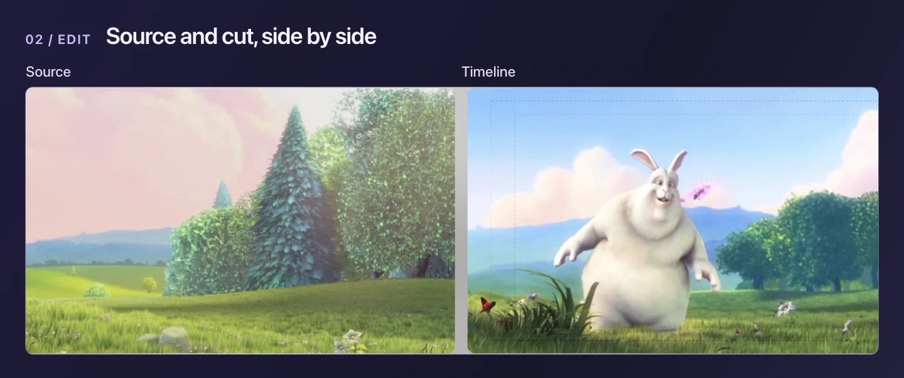

# Reality Video Editor

[English](../../README.md) · [简体中文](zh-Hans.md) · **繁體中文** · [日本語](ja.md) · [한국어](ko.md) · [Français](fr.md) · [Deutsch](de.md) · [Español](es.md) · [Русский](ru.md)

**專為 PICO Space Pro 打造的離線影片剪輯軟體。** 剪雙機訪談時，有時最有戲的，是對方開口前那一瞬間的表情。把反應鏡頭停在素材監看視窗，聽著時間軸上的對白，找出在哪一個字切過去最有味道。從粗剪、調光、混音到輸出，同一個專案都能在頭顯裡完成。素材留在裝置上，剪片不需要帳號或網路。

<a href="../images/reality-video-editor.png">
  <picture>
    <source media="(max-width: 640px)" srcset="../images/showcase/narrow/cover.webp">
    
  </picture>
</a>

[開放原始碼](../../LICENSE) · [建置與安裝](../building.md)

## 找出想留下的那一個鏡頭

看毛片時，素材縮圖和選取鏡頭的預覽就在一起。記下場次、鏡號和拍攝條次，用旗標標出喜歡的片段，或替自己留一句「等他笑完再切」。替反應鏡頭加上關鍵字，就能用智慧型素材箱收集標為好用、卻還沒剪進片裡的鏡頭。用過一顆鏡頭，清單就會跟著更新。

這組畫面來自一支 20 秒的短片 *Meadow Morning*。四段影像和兩段聲音放在同一個素材庫，圖中選取的溪邊鏡頭可以先試看，再決定要從哪裡剪進來。

<a href="../images/showcase/media.webp">
  <picture>
    <source media="(max-width: 640px)" srcset="../images/showcase/narrow/media.webp">
    
  </picture>
</a>

## 把剪輯桌展開在眼前

超寬版面把原始素材和時間軸的監看視窗並排放在軌道上方。聽到一句想留下的回答，設好入點、出點，用插入剪輯讓後面的鏡頭順延，或用覆寫取代時間軸上等長的一段。接上鍵盤可用 **I** 和 **O** 設定入出點。想回頭看看某個表情之後發生什麼事，把播放頭停在那裡，按 **F** 就會回到原始素材的同一影格，再用轉盤逐格往後看。

碰到檔案較大的相機素材，可以先產生輕量的代理檔來剪，最後算圖時會使用原始檔案。

<a href="../images/showcase/workspace.webp">
  <picture>
    <source media="(max-width: 640px)" srcset="../images/showcase/narrow/workspace.webp">
    
  </picture>
</a>

## 找到該切換鏡頭的那一格

溪流還沒入鏡，觀眾就先聽見水聲。把聲音的剪接點提早幾格，畫面晚一點再換，就是一個 J-cut。場面太拖時，用漣漪修剪收掉停頓，後面的鏡頭會一起向前。如果配樂重拍已經對準了，可以滑移片段裡的素材，留下原本的兩個剪接點，換上一個更到位的動作。

時間軸最多容納八條影像軌和八條音軌。剪雙機訪談，可以靠波形把外錄聲音對準相機的參考音，切機位時只切畫面，讓整句對白連貫。想慢慢靠近主角，用兩個縮放關鍵影格就能推近畫面；想讓動作本身放慢，可以用變速曲線帶進慢動作。

<a href="../images/showcase/timeline.webp">
  <picture>
    <source media="(max-width: 640px)" srcset="../images/showcase/narrow/timeline.webp">
    
  </picture>
</a>

## 讓兩個鏡頭接成同一場戲

從陽光下的草地接到樹蔭裡的小溪，兩個鏡頭怎麼才像同一個早晨？先用基礎色輪調好第一鏡，存下參考靜幀，再跟下一鏡分割畫面比對。波形圖能看出暗部落在哪裡，RGB 分量圖用來找偏色。可以把參考畫面的調色套到下一鏡，再接著微調，也能匯入熟悉的 .cube LUT。

人物從亮處走到陰影裡時，替臉部加上邊緣柔和的遮罩視窗，追蹤人物移動，再局部提亮。同一段素材可以保留不同調色版本，方便來回比較原本的色調和較暖的處理。

<a href="../images/showcase/color.webp">
  <picture>
    <source media="(max-width: 640px)" srcset="../images/showcase/narrow/color.webp">
    
  </picture>
</a>

## 替人聲留一點空間

趁著還記得這場戲的語氣，直接把旁白錄進音軌。將對白獨奏，用等化器整理混濁的頻段，再用齒音抑制收一點刺耳的嘶聲。讓配樂在有人說話時自動壓低，把樹林的環境音和其他音效送到同一條混音匯流排，用一支推桿就能一起控制。

最後從頭聽一遍。整體響度（LUFS）反映整支片的聽感音量，真峰值則告訴你最大聲的那一下離削波還有多少餘裕。

<a href="../images/showcase/audio.webp">
  <picture>
    <source media="(max-width: 640px)" srcset="../images/showcase/narrow/audio.webp">
    
  </picture>
</a>

## 從橫式正片剪出直式短版，再配上各語言字幕

橫式正片已經定剪，還需要一支 15 秒的直式預告？複製時間軸，兩個版本就能共用素材庫。把副本改成 9:16，重新安排主角在直式畫面裡的位置，再替手機觀眾剪一個短一點的開場。也可以選擇方形畫幅。

匯入帶時間碼的 SRT 或 WebVTT 字幕，每種語言放在自己的字幕軌，對著同一版畫面校對。輸出時可以選要把哪一軌燒錄到影像裡，也能替每種語言各存一份字幕檔。

## 一條時間軸，輸出多種版本

把整支影片排入算圖佇列，或標出入點和出點，先送一小段給夥伴看片。需要分鏡交付時，也可以逐一輸出片段。影片可選 H.264 或 H.265，也能擷取一格當封面，或另交一份 WAV 給聲音剪輯師。可選的解析度和編碼格式依頭顯的編碼器而定。下圖的成片影格和佇列紀錄都來自 *Meadow Morning* 的同一次輸出，規格是 1080p、每秒 30 格。

<a href="../images/showcase/deliver.webp">
  <picture>
    <source media="(max-width: 640px)" srcset="../images/showcase/narrow/deliver.webp">
    
  </picture>
</a>

## 把還能繼續剪的時間軸交給夥伴

接手的人要在另一套軟體裡剪，可以匯出 FCPXML 1.10，交付多軌影像與聲音的剪接、標記和基本標題。附上原始素材，讓對方重新連結，再附一支參考影片，方便核對調色與效果。如果只需要剪輯決策表，CMX 3600 EDL 可記錄 V1 和前兩條音軌。兩種格式也都能匯入成新的時間軸，依檔名配對素材庫裡現有的檔案。

## 開始使用 Reality Video Editor

若要在頭顯或相容的 PICO 模擬器上執行，請參閱[建置與安裝指南（英文）](../building.md)。在專案庫或剪輯畫面點選地球圖示，就能切換九種介面語言；字幕語言可以另外設定。

本專案的原創程式碼與美術素材採用 [MIT 授權條款](../../LICENSE)。相依套件授權與素材出處請見[第三方聲明](../../THIRD_PARTY_NOTICES.md)。

示範影像選自《Big Buck Bunny》，© 2008 Blender Foundation / [www.bigbuckbunny.org](https://peach.blender.org/)（[CC BY 3.0](https://creativecommons.org/licenses/by/3.0/)）。截圖中的片段經過剪輯。
